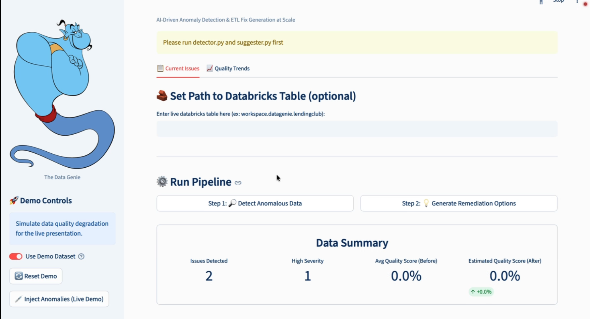
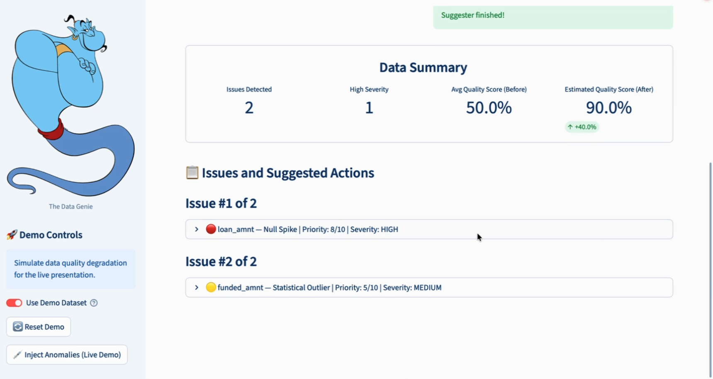
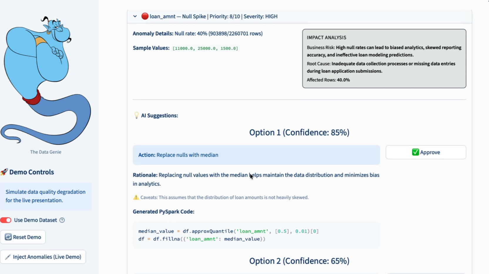
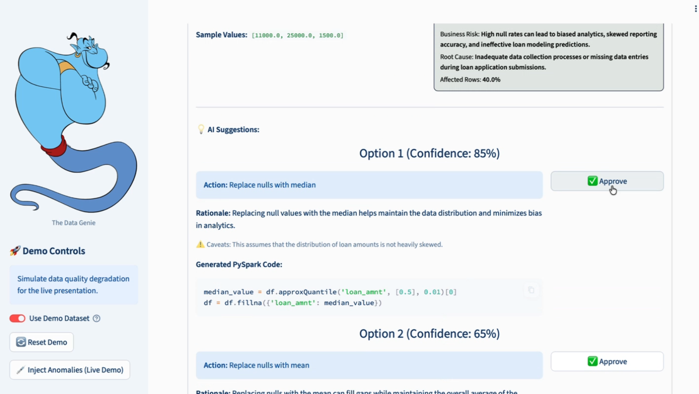
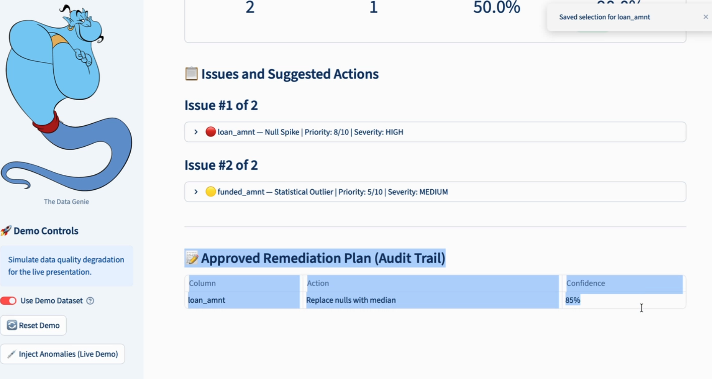

# LLM Data Quality Assistant (DataGenie): course submission snapshot

> **This repository is a snapshot of a team course project. The code is kept exactly as submitted.**
>
> - **Source.** It is mirrored from the team repository [tom666d/big_data_team_6](https://github.com/tom666d/big_data_team_6) at the submission commit `b01ef2e` (2026-04-26). Only this README was rewritten, and the demo screenshots in `docs/demo/` were added.
> - **Team.** Sean Cabaniss, Yung Hsuan Hsieh, Ching-Fen Hung, Yonghui Kim, and Omkar Thombare. It was built for the Big Data Analytics course in the MSBA program at the Carlson School of Management, University of Minnesota. I (Yung Hsuan Hsieh) was the team's LLM engineer and built the LLM pipeline with Ching-Fen Hung.
> - **Follow-up.** I later evaluated this system in [llm_data_quality_evaluation](https://github.com/tom666d/llm_data_quality_evaluation).

---

## What it does

DataGenie scans loan data for data-quality problems, uses an LLM to propose fixes, and lets a human approve them.

1. **Detect.** A PySpark job scans the LendingClub data for three kinds of issues:
   - **null spikes:** a column more than 30% empty;
   - **statistical outliers:** more than 5% of values outside 1.5 × IQR;
   - **mixed date formats:** `issue_d` written both as `Dec-2015` and as `12/2015`.
2. **Diagnose and suggest.** A two-agent GPT-4o-mini pipeline handles each issue.
   - **Agent 1** writes a likely root cause and the business impact.
   - **Agent 2** proposes three ranked options, each with PySpark fix code and a confidence score. The third option is always "decline". It also takes the analyst's past decisions on the same issue type as context.
   - **A critic** checks the format of the answer and asks again if it is wrong.
   - Issues are ranked by a priority score built from severity and the share of rows affected.
3. **Review.** A Streamlit dashboard shows each issue with its diagnosis and options. The analyst approves one. The decision goes into an audit trail and is fed back as context for future suggestions. **No fix is applied automatically.**

For live demos, the dashboard can inject three anomalies into the sample data and reset it:
- 40% of `loan_amnt` emptied;
- 8% of `annual_inc` set to `9999999`;
- 30% of `issue_d` overwritten with `01/2020`.

## Tech stack

PySpark · Databricks · OpenAI GPT-4o-mini · Streamlit · Plotly

It runs locally, or on Databricks through Databricks Connect, deployed as a Databricks App (`app.yaml`).

## Run it

Setup, the local run, and the Databricks deployment are described in [`Instruction.md`](Instruction.md).

```bash
pip install -r requirements.txt
python src/detection/detector_dashboard.py     # 1. detect issues
python src/llm/suggester_dashboard.py          # 2. generate suggestions (needs OPENAI_API_KEY in .env)
streamlit run streamlit_app/app.py             # 3. review in the dashboard
```

## Repository layout

```
src/detection/detector_dashboard.py   the detector used by the dashboard
src/llm/suggester_dashboard.py        the two-agent LLM pipeline
streamlit_app/app.py                  the review dashboard
data/                                 the LendingClub sample, demo data, and pipeline outputs
flyer/DataGenie-2.pdf                 the project flyer
docs/demo/                            dashboard screenshots used in the Demo section
```

## Pipeline

```
 LendingClub sample (100k rows)
        │
 1. DETECT      PySpark finds null spikes, IQR outliers, mixed date formats
        │       → issues_output.json
 2. ROUTE       each issue gets a strategy label: imputation / statistical / standardization
        │
 3. DIAGNOSE    Agent 1: root cause and business impact, plus a priority score
        │
 4. REMEDIATE   Agent 2: 3 ranked options, each with PySpark code and a confidence score
        │                 ▲
 5. VALIDATE    critic: format check, retried up to 2 times
        │                 │
 6. APPROVE     the analyst reviews in Streamlit and approves one option
        │                 │
 7. LEARN       the decision is logged and fed into future suggestions
                → historical_decisions.json
```

| Stage | What happens | Where |
|---|---|---|
| 1. Detect | Flags any column that is more than 30% null; any numeric column with more than 5% of values outside 1.5 × IQR; and `issue_d` mixing `MMM-YYYY` with `MM/YYYY`. Each issue gets a severity | `run_detector()` in [`detector_dashboard.py`](src/detection/detector_dashboard.py) |
| 2. Route | Labels each issue with a remediation strategy, based on its type | `route_issue()` in [`suggester_dashboard.py`](src/llm/suggester_dashboard.py) |
| 3. Diagnose | GPT-4o-mini writes a likely root cause and the business impact. A priority score (1–10) combines severity with the share of rows affected | `diagnose_root_cause()`, `compute_priority_score()` |
| 4. Remediate | GPT-4o-mini proposes three ranked options, each with PySpark code, a confidence score, a rationale, and caveats. Option 3 is always "decline". Past decisions on the same issue type are included as context | `generate_remediation()` |
| 5. Validate | Checks that there are three options, that every option has code, and that option 3 is the decline. If not, it asks again, up to 2 retries | `critic_check()`, `generate_remediation_with_critic()` |
| 6. Approve | The dashboard lists issues by priority, with the diagnosis and options. The analyst approves one. **Nothing is applied automatically** | [`streamlit_app/app.py`](streamlit_app/app.py) |
| 7. Learn | Each approval is saved and used as context in later Agent 2 prompts | `save_decision_to_history()`, `format_historical_context()` |

## Demo

A walkthrough of the dashboard on the demo dataset.

### 1. Run the pipeline

With **Use Demo Dataset** on, click **Step 1: Detect Anomalous Data**, then **Step 2: Generate Remediation Options**. Until both steps have run, the dashboard shows a reminder to run them first.



### 2. Review the detected issues

The summary shows how many issues were found, how many are high severity, and the average quality score before and after the fixes (an estimate). Issues are listed by priority: here, a null spike in `loan_amnt` (8/10, high) and a statistical outlier in `funded_amnt` (5/10, medium).



### 3. Read the diagnosis and the suggested fixes

Opening an issue shows the anomaly details, sample values, and Agent 1's impact analysis: business risk, root cause, and the share of rows affected. Below it are Agent 2's ranked options. Each has an action, a rationale, caveats, PySpark code, and a confidence score.



### 4. Approve an option

The analyst approves one option, here Option 1, "Replace nulls with median" (85% confidence).



### 5. Check the audit trail

The approval is saved to the **Approved Remediation Plan (Audit Trail)** and fed back as context for later suggestions. Nothing is applied to the data automatically.


